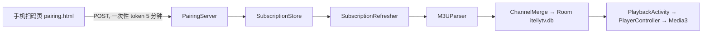

# TVLive 交接文档

> 补写日期：2026-10-24（历史项目补档，非交付时原始文档）
> 修订：2026-11-24 发布前复核 —— 脱敏检查、产物校验值、发布状态、变更历史订正。本次修订**未做任何对外动作**（未 push / 未打 tag / 未建 Release / 未上传更新源）。

## 1. 一句话结论

Android TV 上的 IPTV / 直播播放器（Kotlin + Media3/ExoPlayer，包名 `com.tvlive.tv`）。v2.1.3 已定版，
公开包与私有包两个 APK 已产出，源码推到 GitHub 与自建 Gitea。使用者是「用遥控器看电视直播源」的
家庭用户：装完扫码填 M3U 地址即用，不联网也能看已缓存的订阅。

## 2. 交付物与位置

| 交付物 | 路径 | 版本 | 校验 |
|---|---|---|---|
| 公开版 APK | `dist/TVLive-v2.1.3-release.apk`（4,375,598 字节） | 2.1.3 / versionCode 213 | SHA-256 `6dcd999b8b0286e5591d564973740d0326045764233df2ec7892f0cce2007159` |
| 私有版 APK（含预置订阅） | `dist/TVLive-v2.1.3-private-release.apk`（4,376,425 字节） | 2.1.3 / versionCode 213 | SHA-256 `962123ce79985f34694494658e5de7789b704508859a5a8c2423e4bf2442c207` |
| 源码 | origin `https://github.com/zdx8/TVLive.git`；gitea 自建远端（SSH，真实地址见本机 `git remote -v`） | main 最新提交 | 工作区 `git status --porcelain` 为空 |
| 官网静态页 | `docs/`（`index.html` / `style.css` / `images/` / `.nojekyll`） | 与 main 同步 | 无 `CNAME`，项目 Pages 形态 |

- 发布状态（2026-11-24 已发布）：`docs/index.html` 的下载按钮指向 `https://github.com/zdx8/TVLive/releases/latest`
  （稳定链接，自动指向最新 Release，无需改站点）。
  - GitHub `origin/main` = Gitea `main` = `9ff0ba1`（发布前脱敏复核与文档订正）之后的文档提交，**已 push**；
    发布 tag `v2.1.3` 指向 `9ff0ba1`。
  - 已发布 tag（annotated，GitHub 与 Gitea 一致）：`v2.0.0`（→ `e670f66`）、`v2.1.0`（→ `e5ba7d0`）、
    `v2.1.1`（→ `d120ff4`）、`v2.1.2`（→ `61e7627`）、`v2.1.3`（→ `9ff0ba1`）。
  - GitHub Release `v2.1.2` / `v2.1.3` 已建，各挂公开 APK + 同名 `.sha256`；
    `releases/latest` = v2.1.3，实测 `UpdateAssetPicker` 只选中 `TVLive-v2.1.3-release.apk`。
  - 私有包更新资产放在 Gitea 上的独立更新仓库（仓库名见本机 `.env.sh` 的 `TVLIVE_UPDATE_URL`），
    v2.1.2 / v2.1.3 私有包均已上传；匿名下载实测 200 且 sha256 与本地一致。
  - 官网 Pages `https://zdx8.github.io/TVLive/` 实测 HTTP 200，status=built。
- v2.1.3 前的历史已被重建脱敏（单提交 `e670f66`），**v1.x 历史不在本仓库**（Gitea 上仍存在
  `v1.0.0` / `v1.1.0` / `v1.2.0` 三个 tag，处置见 §5 已知问题）。

## 3. 怎么跑起来

实测环境：macOS 27.2（BuildVersion 26B118，Apple Silicon）；Gradle 8.11.1；AGP 8.6.1 + Kotlin 2.0.21；
构建 JDK 是 `.env.sh` 指定的 17.0.2（`~/jdks/jdk-17.0.2.jdk/Contents/Home`）——本机默认
`java -version` 是 25.x，不用 `.env.sh` 会踩 AGP 的 JDK 版本要求；Android SDK 在
`~/Library/Android/sdk`（`platforms/` 33 / 35 / 36 / 37，`build-tools/` 34.0.0 / 35 / 36 / 37；
34.0.0 是 2026-11-22 补装的，因为 `app/build.gradle.kts` 硬编码该版本）。

```bash
cd "<项目根目录>/TVLive"
source .env.sh
unset http_proxy https_proxy HTTP_PROXY HTTPS_PROXY
./gradlew :app:assembleRelease     # 公开包 → app/build/outputs/apk/release/app-release.apk
./gradlew :app:testDebugUnitTest   # 单测（源码内 139 个 @Test / 15 个测试文件）
scripts/build-private-apk.sh       # 私有包 → dist/TVLive-v<ver>-private-release.apk
```

安装与启动（入口是 `PlaybackActivity`，同时挂 `LAUNCHER` 与 `LEANBACK_LAUNCHER`）：
`adb connect <电视IP>:5555 && adb install -r dist/TVLive-v2.1.3-release.apk`，
再 `adb shell am start -n com.tvlive.tv/.player.PlaybackActivity`。

- 前置条件：JDK 17；SDK 必须含 `platform-35` 与 `build-tools 34.0.0`
  （`app/build.gradle.kts` 硬编码 `buildToolsVersion = "34.0.0"`）；`keystore.properties` 缺失时仍能出包，
  但 release APK 未签名。
- 2026-11-22 已在 JDK 17 + Android SDK（`~/Library/Android/sdk`，build-tools 34.0.0）下实测
  `./gradlew :app:testDebugUnitTest :app:assembleRelease` 全绿；dist/ 内 v2.1.3 两个包为本机重打产物。

## 4. 架构与关键设计

`app/src/main/java/com/tvlive/tv/`：56 个 Kotlin 文件 / 9,617 行，0 个 Java 文件。

```
com.tvlive.tv/
├── AppConfig.kt / TvLiveApp.kt / CrashLog.kt    常量、初始化、崩溃落盘
├── player/    PlaybackActivity(880) PlayerController(835) ChannelDrawer(285) StreamDiagnoser(282)
├── ui/        MainActivity(621，磁贴主页，exported=false) + 频道行/数字键缓冲
├── pairing/   PairingActivity + PairingServer(259) + QrBitmap（局域网 HTTP 收订阅）
├── data/      m3u/M3UParser(344) store/SubscriptionStore repository/ChannelRepository(256)
│              model+source（Room 实体/DAO） source/ChannelMerge（原地合并，保收藏）
├── update/    UpdateManager(313)：拉 releases/latest 或静态清单
└── widget/    MaxHeightScrollView 等
```



> 决策：HTTP 用 `java.net.HttpURLConnection` 而非 OkHttp → 为什么：`app/build.gradle.kts` 注释记录
> 部分 Android 9 国产电视盒上 okio 原生库崩溃 → 代价：无连接池/拦截器，超时手写 →
> 推翻条件：目标机型全为 Android 10+ 且不再出现 okio 崩溃。

> 决策：`versionCode = 200`（主版本对齐 2xx）→ 为什么：必须大于 1.2.x 时代的 22，否则覆盖安装报
> `INSTALL_FAILED_VERSION_DOWNGRADE` → 代价：版本号空间被压缩 → 推翻条件：现场已无 1.2.x 装机。

> 决策：订阅靠「电视起临时 HTTP 服务 + 手机扫码填表」录入 → 为什么：遥控器输长 URL 不可用，
> 且订阅地址不出局域网 → 代价：manifest 需 `usesCleartextTraffic="true"` → 推翻条件：改手机 App 直连。

## 5. 已完成 / 未完成 / 已知问题

已完成：M3U/M3U8 订阅（远程/本地/单流直连）、扫码填源、多订阅切换与原地合并刷新、频道抽屉与
数字键跳台、长按收藏、重连退避 + 15s 看门狗、连败跳台、应用内自更新（仅手动触发）、边到边 UI、
私有包注入机制、R8 + 资源压缩（release 4.3 MB）、15 个测试文件共 139 个 `@Test`。

未完成：录制、多画面。EPG 节目单已在 v2.1.0 完成；v2.1.1 修复了更新弹窗说明撑满屏幕、按钮不可按的问题；v2.1.2 私有包更新源改走本机 Gitea，并修复公开包误下载私有 APK 的订阅泄露隐患；v2.1.3 优化 EPG 加载：弹窗主动加载+进度、精简二进制缓存、边下边解析、多源并发，冷启动加载 458ms→14ms。

已知问题（严重度）：

- **已处理**：公开 GitHub Release `v2.1.0` / `v2.1.1` 上原挂着 `*-private-release.apk` 资产，而私有包内嵌
  `assets/private-subscriptions.json`（含个人订阅地址）→ 任何人都能从公开 Release 下载到私有包并读出该地址。
  2026-11-24 已删除这两个私有包资产（HTTP 204），三个 Release 现在只剩公开 APK。
  另注：v2.1.2 起用 `UpdateAssetPicker` 严格区分公开/私有资产，解决的是「公开包误下私有包」；
  删除资产同时让 v2.1.0/v2.1.1 旧客户端的「取第一个 `-release.apk` 资产」逻辑回到正确行为。
- **影响发布**：Gitea 远端存在 `v1.0.0` / `v1.1.0` / `v1.2.0` 三个 tag，其提交作者是真实姓名与邮箱。
  本地已删除这三个 tag，但 `git fetch gitea --tags` 会把它们重新拉回，随后的 `git push origin --tags`
  会把它们推上公开 GitHub。仓库 pre-push 闸门此前只扫 `HEAD` 可达提交，查不到 tag-only 链；
  2026-11-24 已改为按本次推送的每个 ref 取新提交。**v1.x 不得再推到公开仓库。**
- **遗留**：`scripts/build-private-apk.sh` 的用法提示曾写死真实设备内网地址，该行随 `d120ff4`
  已发布在 GitHub。2026-11-24 起改为占位符 `<电视IP>:5555`；**已发布历史里的旧值仍在**，要彻底抹除
  只能重写历史 + force-push（会改 v2.0.0/v2.1.0/v2.1.1 三个 tag 的指向），未执行。
- **遗留**：Gitea 更新仓库在 Gitea 实例内是 `private: false`（电视端要匿名拉取更新清单，不能改成私有）。
  该实例只在 Tailscale / WireGuard 内网可达，未发现公网入口；但**私有包内的订阅地址随包分发**，
  拿到私有包的人就能读到。
- **影响体验**：README 引用的 `docs/扫码填源-设计方案.md` 不存在（`docs/` 只剩官网文件）。
- **影响体验**：`UpdateManager.kt:33` 与 README 都提到 `scripts/make_update_manifest.py`，
  实际 `scripts/` 只有 `build-private-apk.sh` / `diagnose.sh` / `make_wallpaper.py` /
  `test-on-device.sh`；README 说的「NAS 清单 + GitHub 双模式」在 `AppConfig.kt` 只有
  `UPDATE_MANIFEST_URL`（GitHub `releases/latest`）一个常量。
- **边缘**：`AppConfig.kt:41` 注释写更新附件名为 `*-public-release.apk`，实际发的是
  `TVLive-v2.1.3-release.apk`（注释已修正）；`NOTICE` 不再引用不存在的 THIRD-PARTY-LICENSES。
- **边缘**：`scripts/diagnose.sh`、`scripts/test-on-device.sh` 启动的是 `exported="false"` 的
  `MainActivity`；非 root 设备上该 `am start` 能否成功：未验证：本次未连设备。
- **边缘**：Room 数据库文件名仍是历史名 `itellytv.db`（`TVLiveDatabase.kt:33`），与应用名不一致。

## 6. 外部依赖与凭据

依赖（`app/build.gradle.kts` 实际值）：Media3/ExoPlayer 1.7.0（exoplayer / hls / dash / rtsp / ui /
session / common，Apache 2.0）；AndroidX leanback 1.0.0、leanback-tab 1.1.0-beta01、core-ktx 1.10.1、
appcompat 1.6.1、activity 与 activity-ktx 1.7.2、fragment 与 fragment-ktx 1.5.7；Room 2.7.0
（`room-runtime` / `room-ktx` + `kapt room-compiler`）；Material 1.10.0；kotlinx-coroutines-android 1.7.3；
kotlinx-serialization-json 1.6.3；ZXing core 3.5.3；JUnit 4.13.2（仅测试）。`resolutionStrategy.force`
钉住 activity 1.7.2 与 lifecycle 2.6.1。许可证 **Apache 2.0**（`LICENSE`）。

凭据（只写位置，不写明文）：
- 签名配置：仓库根 `keystore.properties`，键为 `storeFile` / `storePassword` / `keyAlias` /
  `keyPassword`；已被 `.gitignore` 排除（规则 `keystore.properties`）。模板 `keystore.properties.example`。
- keystore 二进制：`app/signing/` 下 `*.keystore` / `*.jks`，同样被 `.gitignore` 排除
  （规则 `app/signing/*.keystore`、`app/signing/*.jks`）。
- Git：GitHub 走 https（`origin`），Gitea 走 SSH（`gitea` 远端，本机 SSH 身份）。
- 更新通道：`https://api.github.com/repos/zdx8/TVLive/releases/latest`，匿名 GET，无 token。

## 7. 数据与配置在哪

- 偏好 `hftv_home`（`AppConfig.PREFS_NAME`，键 `active_subscription`）+ Room 库 `itellytv.db`（订阅/频道/收藏/最近）。
- 私有订阅注入：`app/assets-private/private-subscriptions.json`（84 字节，`.gitignore` 排除，
  仅 `-PprivateSubs=true` 时挂进 assets）。
- 崩溃日志：`/sdcard/Android/data/com.tvlive.tv/files/last_crash.txt`（每次崩溃覆盖）。
- 构建环境：`.env.sh`（本机路径，`.gitignore` 排除）；`local.properties` 的 `sdk.dir` 指向上面那个 SDK。
- 重置到初始状态：
  ```bash
  adb shell pm clear com.tvlive.tv
  adb shell rm -f /sdcard/Android/data/com.tvlive.tv/files/last_crash.txt
  ```

## 8. 维护手册（出问题先看这里）

| 现象 | 排查步骤 | 日志位置 |
|---|---|---|
| 启动闪退 | 拉 `last_crash.txt` 看 `stage` 与异常类，再 `adb logcat -s AndroidRuntime:E` 复现 | `/sdcard/Android/data/com.tvlive.tv/files/last_crash.txt` |
| 播放黑屏/卡死 | 看门狗 15s 无进度自动重连（1s/2s/4s，最多 3 次），连败跳台；用 `StreamDiagnoser` 区分拉流失败与解码失败 | `adb logcat -s TVLive.Player:I` |
| 扫码页打不开 | 确认手机与电视同网段；token 5 分钟过期需重开配对页；服务绑随机端口，注意防火墙 | `adb logcat -s TVLive:D` |
| 刷新后收藏丢失 | 正常走 `ChannelMerge` 原地合并；异常时检查私有目录 `itellytv.db` 是否存在 | 同上 |
| 覆盖安装报 VERSION_DOWNGRADE | 用 `aapt2 dump badging` 首行确认 `versionCode >= 200` | — |
| 检查更新总说「已是最新」 | 国内访问 `api.github.com` 常失败，失败即按「已最新」处理，属预期行为 | 同上 |

## 9. 复现与验证清单

以下输出为本机实测值（标注「未验证」者除外）：

```bash
# 1. 产物哈希
shasum -a 256 dist/*.apk
# 预期：962123ce…4c207  TVLive-v2.1.3-private-release.apk
#       6dcd999b…07159  TVLive-v2.1.3-release.apk
# 2. 包名与版本
"$HOME/Library/Android/sdk/build-tools/34.0.0/aapt2" \
  dump badging dist/TVLive-v2.1.3-release.apk | head -3
# 预期：package: name='com.tvlive.tv' versionCode='213' versionName='2.1.3' … compileSdkVersion='35'
#       sdkVersion:'23' / targetSdkVersion:'35'
# 3. 两个包的实质差异
unzip -l dist/TVLive-v2.1.3-release.apk | grep private-subscriptions          # 预期：无输出（exit 1）
unzip -l dist/TVLive-v2.1.3-private-release.apk | grep private-subscriptions  # 预期：84 字节的 assets/private-subscriptions.json
# 4. 签名证书
"$HOME/Library/Android/sdk/build-tools/34.0.0/apksigner" \
  verify --print-certs dist/TVLive-v2.1.3-release.apk | grep 'certificate DN'
# 预期：Signer #1 certificate DN: CN=iTellyTV, OU=zdx8, O=zdx8, L=Beijing, ST=Beijing, C=DN
#       Verified using v1 scheme (JAR signing): true
#       Verified using v2 scheme (APK Signature Scheme v2): true
#       Verified using v3 scheme (APK Signature Scheme v3): false
#       （公开包与私有包同一证书：证书 SHA-256 5a5dc4d3…2a90）
# 5. 版本与提交
git tag && git log --oneline -1   # 预期：v2.0.0 / v2.1.0 / v2.1.1（v2.1.2 / v2.1.3 发布后追加） / …

# 6. 工作区干净度
git status --porcelain | wc -l    # 预期：0

# 7. 代码规模与测试数
find app/src -name '*.kt' | wc -l                                   # 预期：56
find app/src -name '*.kt' -print0 | xargs -0 wc -l | tail -1        # 预期：9617 total
grep -rh '@Test' app/src/test | wc -l                               # 预期：139

# 8. 构建与单测（2026-11-22 实测）
source .env.sh && ./gradlew :app:assembleRelease :app:testDebugUnitTest
# 预期：BUILD SUCCESSFUL，产物 app/build/outputs/apk/release/app-release.apk

# 9. 发布前脱敏复核（2026-11-24 实测，见 §5 已知问题）
#    项目专属敏感词（真实姓名 / 个人域名 / 内网地址）只放在本机 ~/bin/gh-pii-check 里，
#    不写进本仓库 —— 免得「要扫的词」本身又出现在公开文件里。
git cat-file --batch-all-objects --batch-check='%(objecttype) %(objectname)' \
  | awk '$1=="commit"{print $2}' | git log --no-walk --stdin --format='%an <%ae>' \
  | grep -Ev 'users\.noreply\.github\.com'          # 预期：无输出
"$HOME/bin/gh-pii-check" --history .                    # 预期：PASS: 未发现个人信息/敏感文件
git fsck --unreachable --no-progress 2>/dev/null | grep -c 'unreachable commit'  # 预期：0
```

## 10. 下一步建议

1. **真机验证更新弹窗**：v2.1.1 发行后，在旧版设备上点「检查更新」，确认说明区定高可滚动、
   「以后 / 立即更新」两键可见可按；代码层已用 formatter 单测覆盖，真机交互仍待确认。
2. **真机验证 EPG 焦点**：按 GUIDE 后 D-pad 上下能否移动高亮、长节目单能否滚动。
3. **文档引用已修**：README 死链、`THIRD-PARTY-LICENSES`、诊断脚本入口三项已在 v2.1.0/v2.1.1 处理完毕。
4. **DB 改名**：`itellytv.db` → `tvlive.db` 需一次 Room 迁移（动 `TVLiveDatabase.kt`）；
   若加多画面，从 `data/model/Entities.kt`、`data/source/Daos.kt` 加表，`ui/` 加面板。

### v2.1.2 / v2.1.3 发布待放行清单

### 发布执行记录（2026-11-24，根哥放行后执行）

| # | 动作 | 实测结果 |
|---|---|---|
| 1 | 删除公开 GitHub Release `v2.1.0` / `v2.1.1` 上的 `*-private-release.apk` 资产 | HTTP 204 ×2；三个 Release 现在只剩公开 APK ✓ |
| 2 | **重写已发布历史以抹掉旧设备内网地址** | **未执行** —— 需 force-push 且会改三个已发布 tag 的指向，属独立决策 |
| 3 | push 源码到 GitHub 与 Gitea | `d120ff4..9ff0ba1 main -> main` ×2；pre-push 闸门 PASS ✓ |
| 4 | 打 annotated tag `v2.1.2` / `v2.1.3` 并推到两端 | 显式点名推送（未用 `--tags`）；GitHub 与 Gitea tag 列表一致，**GitHub 上 v1.x 为 0** ✓ |
| 5 | 建 GitHub Release `v2.1.2` / `v2.1.3`，挂公开 APK + `.sha256` | HTTP 201 ×2；资产上传 HTTP 201 ×4；从 Release 下载实测 sha256 与 `.sha256` 一致 ✓ |
| 6 | 上传 v2.1.3 私有包 + `.sha256` 到 Gitea 更新仓库 | HTTP 201 ×2；`releases/latest` = v2.1.3；**匿名**下载 200 且 sha256 一致 ✓ |
| 7 | 改线上更新源 / 官网下载按钮 | **无需改** —— 按钮指向 `releases/latest`（自动指向 v2.1.3）；`docs/` 无写死版本号；Pages status=built、实测 HTTP 200 ✓ |

发布后复核：`releases/latest` 模拟一次应用更新检查 → `UpdateAssetPicker` 只选中
`TVLive-v2.1.3-release.apk`（`.sha256` 资产因不以 `-release.apk` 结尾被正确排除）。

## 11. 变更历史

| 日期 | 版本 | 改了什么 |
|---|---|---|
| 2026-11-24 | v2.1.3 | **已发布**：删除公开 Release 上的两个私有包资产（个人订阅地址外泄已封）、源码与两个 tag 推到 GitHub 与 Gitea、GitHub Release v2.1.2/v2.1.3 建好并挂公开 APK + `.sha256`、Gitea 私有更新通道上传 v2.1.3 私有包；发布后复核 sha256 与更新通道选取均正确 |
| 2026-11-24 | — | 发布准备：脱敏复核（脚本里的真实设备内网地址改为占位符、私有端点从公开文档去标识）、产物校验值订正、发布状态与变更历史订正 |
| 2026-11-22 | v2.1.3 | EPG 加载优化：GUIDE 弹窗主动加载并显示进度、并发合并请求；缓存改为 EpgIndex 二进制序列化（14.8MB→2.6MB，冷启动 458ms→14ms）；边下边解析免全量写盘；多源并发取首个成功。139 测试全绿，未发布 |
| 2026-11-22 | v2.1.2 | 私有包更新源改走 Gitea 公开更新仓库；新增 UpdateAssetPicker 严格区分公开/私有 APK，消除公开包误装私有包的订阅泄露隐患；更新地址构建期注入，内网 IP 不进公开源码 |
| 2026-11-22 | v2.1.1 | 修复更新弹窗说明撑满屏幕导致按钮不可按；ReleaseNotesFormatter 清洗+限长；弹窗说明区改为可滚动定高；打 tag `v2.1.1` |
| 2026-11-22 | v2.1.0 | EPG 电子节目单 + bug 修复 + 脱敏重建历史，打 tag `v2.1.0` |
| 2026-10-23 | v2.0.0 | 电视直播 TVLive v2.0.0（历史已脱敏重建为 `e670f66`，tag `v2.0.0` 指向它） |
| 2026-10-23 | — | 官网主题色改 logo 翠绿 #27BF84，hero 展示应用图标 |
| 2026-10-23 | — | 官网主题色统一为 logo 蓝 #275CBF |
| 2026-10-23 | — | logo/横幅改矢量 SVG，修 hero 布局错位 |
| 2026-10-23 | — | style.css 加版本参数避免 CDN 缓存旧主题色 |
